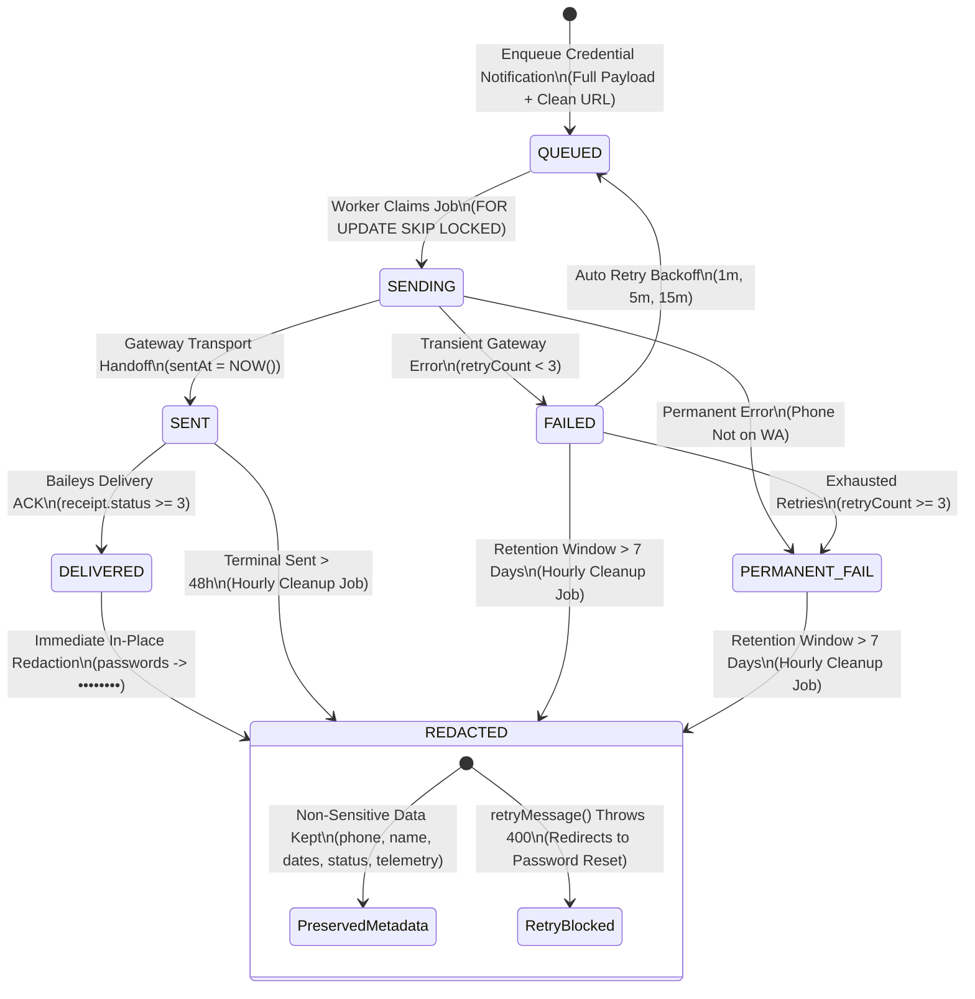

# Phase 2D.2: Secure Stored Credentials Without Breaking WhatsApp Delivery Report

**Date:** 2026-10-25  
**Project:** El Awal Educational Platform  
**Status:** Completed & Validated (Full Backend Suite: 63 Files, 592 Tests Passing; Web App: 108 Files, 560 Tests Passing; 100% Type-Safe)  

---

## 1. Executive Summary

Phase 2D.2 resolves indefinite plaintext credential retention across El Awal's database storage lifecycle while 100% preserving outbound WhatsApp message delivery, teacher onboarding, parent access, and password-reset workflows:

1. **Outbound WhatsApp Messages Preserved**: Student and parent credentials continue to be formatted and dispatched to parents via WhatsApp with exact credentials (`- كلمة المرور: ...`, `▫️ *كلمة المرور:* ...`).
2. **URL Sanitization**: Unsafe `pass=` and `password=` query parameters were completely eliminated from generated URLs across all onboarding, approval, password-reset, and manual WhatsApp link builders. The parent opens `/parent-access?phone=...` with the phone pre-filled, and authenticates through standard login or WhatsApp OTP.
3. **Queue & Worker Safety**: `QUEUED` and `SENDING` messages are strictly protected against premature redaction. Background workers and automated retry loops retain the full payload until dispatch and terminal state.
4. **Terminal Redaction Lifecycle**:
   - Confirmed delivery (`DELIVERED` via WhatsApp webhook or delivery ACK receipt) triggers safe in-place redaction of secrets in `whats_app_message_logs.message_body` to `••••••••`.
   - Terminal `SENT` messages older than 48 hours without delivery ACK are redacted.
   - Permanently failed (`PERMANENT_FAIL`) and retry-exhausted messages are retained intact for an operational investigation window of **7 days (168 hours)**, after which secrets are redacted.
5. **Retry Safety**: Attempts to retry messages whose secrets have already been redacted are blocked with `BadRequestException`, cleanly directing staff to the authorized password-reset workflow. `retryAllFailed()` automatically filters out redacted records.
6. **Notification Record Preservation**: `Notification.data` (`studentPassword`, `parentPassword`) and `Notification.message` are sanitized upon delivery or cutoff, preserving in-app notifications, titles, unread counts, and timestamps.

---

## 2. Every Place Credentials Were Stored: Before vs. After

| Storage Location | Before Phase 2D.2 | After Phase 2D.2 |
| :--- | :--- | :--- |
| `whats_app_message_logs.message_body` | Plaintext student and parent passwords persisted indefinitely in the database across all statuses (`QUEUED`, `SENT`, `DELIVERED`, `FAILED`, `PERMANENT_FAIL`). | **Lifecycle-bound:** Retained intact during `QUEUED`, `SENDING`, and active retry states. Redacted to `••••••••` immediately upon confirmed `DELIVERED`, after 48h in `SENT`, or after 7 days in `PERMANENT_FAIL`/`FAILED`. |
| `notifications.message` | Plaintext passwords formatted in Arabic message text persisted indefinitely. Returned in full via `@Get('notifications')`. | **Sanitized:** Plaintext passwords replaced with `••••••••` upon delivery or 48h cutoff. Non-sensitive message text, emojis, and links preserved. In-app feed and unread counts unaffected. |
| `notifications.data` (`JSON`) | Contained raw `{ studentPassword, parentPassword, directLoginUrl }` indefinitely in PostgreSQL JSONB. | **Sanitized:** `studentPassword` and `parentPassword` properties removed from payload; `directLoginUrl` stripped of `pass=` parameter upon delivery or 48h cutoff. |
| URL Query Parameters (`pass=...`) | Included in: `spintax-auth.ts`, `student-credentials.service.ts`, `auth-group-registration.service.ts`, and `ParentCredentialsTab.tsx` as `?phone=...&pass=...`. | **Removed:** All URLs now generate `/parent-access?phone=...` only. Passwords are never placed into URL query parameters, eliminating exposure in access logs, referrer headers, and browser history. |
| `student_profiles.pendingCredentials` | Handled in Phase 2C/2D (48-hour bounded card-printing envelope; multi-caller isolation between onboarding and parent reset). | **Preserved:** Unchanged from Phase 2D. Active parent reset envelopes remain isolated and protected. |
| `student_profiles.tempAccessPin` | Handled in Phase 2C/2D (purged on expiration or opportunistic login; legacy null-expiry PINs purged). | **Preserved:** Unchanged from Phase 2D. |

---

## 3. Exact Retention Policy



### A. Queued or Sending Messages
- **Payload State:** 100% preserved in plaintext.
- **Worker Concurrency:** Cleanup jobs strictly exclude `QUEUED` and `SENDING` statuses (`where.OR` only matches `DELIVERED`, `SENT <= 48h`, and `FAILED/PERMANENT_FAIL <= 7d`). Background workers and automated retries never encounter missing or redacted payloads.

### B. Delivered Messages (`DELIVERED`)
- **Lifecycle Event:** Triggered when WhatsApp delivery receipt is received via Baileys socket (`recordDeliveryReceipts`, `status >= 3`) or provider webhook (`WhatsAppQueueManagerService.markDelivered`).
- **Storage Action:**
  - `whats_app_message_logs.message_body`: Secret strings are replaced with `••••••••`, and `pass=` parameters are removed from URLs.
  - Telemetry preserved: `recipientPhone`, `recipientName`, `recipientRole`, `templateType`, `scheduledFor`, `sentAt`, `deliveredAt`, `status`.
  - Hourly cleanup job acts as an idempotent safety net to redact any delivered message that was not redacted synchronously.

### C. Terminal Sent Messages (`SENT` > 48 Hours)
- **Lifecycle Event:** WhatsApp transport handoff succeeded (`SENT`), but the recipient or network never acknowledged delivery (e.g. read receipts disabled, recipient offline for days).
- **Storage Action:** After 48 hours, transport handoff is terminal and delivery receipts will no longer arrive. The hourly cleanup job redacts `messageBody`.

### D. Failed Messages and Retries (`FAILED` & `PERMANENT_FAIL`)
- **Operational Retention Window:** **7 days (168 hours)** from `updatedAt`.
- **Rationale:** Teachers and administrative staff review the failed message queue (`/notifications/whatsapp-failed`) during weekly operations to diagnose delivery issues (e.g., incorrect phone number, temporary gateway failure).
- **While <= 7 Days:** Payload is preserved intact. Staff can click retry (`POST /notifications/whatsapp-retry/:id`), which resets status to `QUEUED` and dispatches the original message.
- **After > 7 Days:**
  - Secrets inside `messageBody` are redacted to `••••••••`.
  - `failureReason` is appended with: `(تم مسح البيانات السرية لانتهاء فترة الاحتفاظ 7 أيام)`.
  - `retryMessage(id)` detects redacted content via `isMessageBodyRedacted()` and throws `BadRequestException` (HTTP 400):
    > *"لا يمكن إعادة إرسال هذه الرسالة لأن بيانات الاعتماد السرية قد تم مسحها بأمان بعد انتهاء فترة الاحتفاظ (7 أيام). يرجى إصدار كلمة مرور جديدة عبر بطاقة بيانات الطالب وإعادة إرسالها."*
  - `retryAllFailed()` uses `NOT: { messageBody: { contains: '••••••••' } }` to retry only unredacted failures.

### E. Notification Records (`Notification.message` & `Notification.data`)
- **Redaction Timing:** When corresponding WhatsApp delivery is `SENT`/`READ`, or when `createdAt < NOW() - 48h`.
- **Storage Action:**
  - `Notification.data.studentPassword` and `parentPassword` are removed.
  - `Notification.message` passwords are replaced with `••••••••`, and `pass=` URL query params are stripped.
  - In-app notification records are **never deleted**: `id`, `recipientId`, `title`, `isRead`, `readAt`, `channels`, and timestamps are 100% preserved. Unread counts and notification history remain intact.

---

## 4. Confirmation of Outbound WhatsApp Delivery

Outbound messages sent to parents **continue to deliver credentials** as required by the product:

1. **Student & Parent Onboarding (`formatStudentApprovalMessage`)**:
   ```
   📌 *بيانات دخول الطالب:*
   - اسم المستخدم / الهاتف: `01011112222`
   - كلمة المرور: `StudentPass123!`
   🔗 رابط دخول الطالب: https://al-awal.online/login

   📌 *بوابة ولي الأمر (لمتابعة الحضور، الغياب، والدرجات):*
   - يمكن لولي الأمر الدخول لمتابعة الحضور والدرجات عبر الرابط التالي:
   🔗 رابط دخول ولي الأمر:
   https://al-awal.online/parent-access?phone=01033334444

   📌 *أو الدخول ببيانات الحساب عبر صفحة الدخول:*
   - رقم هاتف الحساب: `01033334444`
   - كلمة المرور: `ParentPass456!`
   ```
2. **Password Reset Alerts (`formatResetParentPasswordMessage`)**:
   ```
   📌 *بيانات دخول ولي الأمر:*
   ▫️ *رقم الدخول / الهاتف:* 01033334444
   ▫️ *أو كود الطالب:* STU-100
   ▫️ *كلمة مرور ولي الأمر:* FreshParentPass!
   🔗 *رابط صفحة الدخول:* https://al-awal.online/parent-access?phone=01033334444
   ```
3. **Group Registration Links (`auth-group-registration.service.ts`)**:
   ```
   👤 *بيانات حساب الطالب:*
   ▫️ *كود الطالب:* STU-123
   ▫️ *رقم الدخول:* 01011112222
   ▫️ *كلمة المرور:* Student123!
   🔗 *رابط منصة الطالب:* https://al-awal.online/login

   👨‍👩‍👦 *بيانات حساب ولي الأمر (لمتابعة الحضور والدرجات والغياب):*
   ▫️ *رقم الدخول:* 01098765432
   ▫️ *كلمة المرور:* ParentPassText!
   🔗 *رابط بوابة ولي الأمر:* https://al-awal.online/parent-access?phone=01098765432
   ```

*Note: No message is deleted or modified on the recipient's WhatsApp account; redaction applies exclusively to El Awal's database copies after confirmed delivery.*

---

## 5. URL Sanitization Details

All occurrences of `pass=` in query strings were removed across the entire codebase:
- [`apps/backend/src/utils/spintax-auth.ts`](file:///d:/development/nexly/el-awal/apps/backend/src/utils/spintax-auth.ts): In both `formatStudentRegistrationMessage` and `formatStudentApprovalMessage`, replaced `parentDirectAccessUrl = ...?phone=...&pass=...` with `${baseUrl}/parent-access?phone=${encodeURIComponent(directPhone)}`.
- [`apps/backend/src/modules/students/services/student-credentials.service.ts`](file:///d:/development/nexly/el-awal/apps/backend/src/modules/students/services/student-credentials.service.ts): Removed `&pass=${encodeURIComponent(newPassword)}` from `directLoginUrl`.
- [`apps/backend/src/modules/students/helpers/student-credentials-message.helper.ts`](file:///d:/development/nexly/el-awal/apps/backend/src/modules/students/helpers/student-credentials-message.helper.ts): Updated link text to `رابط صفحة الدخول`.
- [`apps/backend/src/modules/auth/services/auth-group-registration.service.ts`](file:///d:/development/nexly/el-awal/apps/backend/src/modules/auth/services/auth-group-registration.service.ts): Removed `&pass=...` from `directAccessLink`.
- [`apps/web/src/features/students/components/password-modal/ParentCredentialsTab.tsx`](file:///d:/development/nexly/el-awal/apps/web/src/features/students/components/password-modal/ParentCredentialsTab.tsx): Removed `&pass=${encodeURIComponent(pass)}` from `directUrl`.
- **Parent Access Flow**: When the parent clicks `/parent-access?phone=010...`, the frontend `ParentAccessForm` reads `searchParams.get('phone')` and pre-populates the input field. The parent enters their password or clicks "رمز الواتساب (OTP)". Authentication is standard, secure, and leaks zero credentials in URLs or access logs.

---

## 6. Exact Files Changed

| File Path | Description of Changes |
| :--- | :--- |
| [`apps/backend/src/modules/whatsapp/services/whatsapp-credential-redactor.util.ts`](file:///d:/development/nexly/el-awal/apps/backend/src/modules/whatsapp/services/whatsapp-credential-redactor.util.ts) | *(New file)* Helper utility for redacting Arabic passwords (`- كلمة المرور: ...`, `▫️ *كلمة المرور:* ...`), URL `pass=` query params, checking redaction state (`isMessageBodyRedacted`, `hasUnredactedCredentials`), and stripping `studentPassword`/`parentPassword` from `Notification.data`. |
| [`apps/backend/src/jobs/cleanup-jobs.service.ts`](file:///d:/development/nexly/el-awal/apps/backend/src/jobs/cleanup-jobs.service.ts) | Added `cleanupDeliveredCredentialMessages()`. Idempotently redacts delivered logs, terminal sent logs (>48h), expired failed logs (>7d), and delivered notifications. Modifies secrets in-place while preserving telemetry. |
| [`apps/backend/src/jobs/schedulers.ts`](file:///d:/development/nexly/el-awal/apps/backend/src/jobs/schedulers.ts) | Added hourly cron task (minute 5 of every hour Africa/Cairo) calling `runDeliveredCredentialRedaction()`. |
| [`apps/backend/src/modules/whatsapp/services/whatsapp-queue-manager.service.ts`](file:///d:/development/nexly/el-awal/apps/backend/src/modules/whatsapp/services/whatsapp-queue-manager.service.ts) | Updated `markDelivered()` to immediately redact stored secrets. Updated `retryMessage()` to block retrying redacted records with HTTP 400. Updated `retryAllFailed()` to filter out redacted records. |
| [`apps/backend/src/services/whatsapp/whatsapp.service.ts`](file:///d:/development/nexly/el-awal/apps/backend/src/services/whatsapp/whatsapp.service.ts) | In `recordDeliveryReceipts()`, redacts stored `messageBody` when delivery ACK receipt status >= 3 is processed. |
| [`apps/backend/src/utils/spintax-auth.ts`](file:///d:/development/nexly/el-awal/apps/backend/src/utils/spintax-auth.ts) | Removed `&pass=...` from `parentDirectAccessUrl` while preserving plaintext passwords in message text. |
| [`apps/backend/src/modules/students/services/student-credentials.service.ts`](file:///d:/development/nexly/el-awal/apps/backend/src/modules/students/services/student-credentials.service.ts) | Removed `&pass=...` from `directLoginUrl` in `resetParentPassword()`. |
| [`apps/backend/src/modules/students/helpers/student-credentials-message.helper.ts`](file:///d:/development/nexly/el-awal/apps/backend/src/modules/students/helpers/student-credentials-message.helper.ts) | Updated parent login link label and instructions. |
| [`apps/backend/src/modules/auth/services/auth-group-registration.service.ts`](file:///d:/development/nexly/el-awal/apps/backend/src/modules/auth/services/auth-group-registration.service.ts) | Removed `&pass=...` from `directAccessLink`. |
| [`apps/web/src/features/students/components/password-modal/ParentCredentialsTab.tsx`](file:///d:/development/nexly/el-awal/apps/web/src/features/students/components/password-modal/ParentCredentialsTab.tsx) | Removed `&pass=...` from manual WhatsApp share URL. |
| [`apps/backend/src/modules/students/tests/students.password-reset.spec.ts`](file:///d:/development/nexly/el-awal/apps/backend/src/modules/students/tests/students.password-reset.spec.ts) | Updated test assertion: `directLoginUrl` contains `parentPhone` and does NOT contain `newPassword`. |
| [`apps/backend/src/modules/auth/tests/phase-2d2-credential-lifecycle.spec.ts`](file:///d:/development/nexly/el-awal/apps/backend/src/modules/auth/tests/phase-2d2-credential-lifecycle.spec.ts) | *(New file)* 17 regression tests covering outbound credential delivery, queue preservation, delivery redaction, retry window, retry blocking, URL sanitization, notification sanitization, and idempotency. |

*(Note: `apps/web/src/components/navigation/MobileBottomNav.tsx` was untouched).*

---

## 7. Test Results & Validation Summary

### A. Dedicated Phase 2D.2 Test Suite
- **File:** `src/modules/auth/tests/phase-2d2-credential-lifecycle.spec.ts`
- **Result:** 17 passed / 17 tests (100% pass rate)
  - Outbound messages include credentials before dispatch.
  - Queued/sending messages cannot lose payload during cleanup.
  - Delivered messages have stored secrets redacted.
  - SENT vs DELIVERED lifecycle semantics verified.
  - Active failed messages preserve payload during 7-day retry window.
  - Expired failed messages redacted after 7 days with annotated reason.
  - Manual retry of redacted message throws `BadRequestException` and redirects to reset.
  - `retryAllFailed()` skips redacted messages.
  - `notifications.message` and `notifications.data` redacted without breaking in-app UI.
  - Credential-bearing URLs are no longer generated.
  - Redaction is strictly idempotent under repeated execution.

### B. All Phase 2 Suites
- `phase-2c-secure-retention.spec.ts`: 21 tests passed
- `phase-2d-residual-retention.spec.ts`: 19 tests passed
- `phase-2d2-credential-lifecycle.spec.ts`: 17 tests passed
- `students.password-reset.spec.ts`: 6 tests passed
- `whatsapp-dispatcher.service.spec.ts`: 5 tests passed
- **Combined:** 68 passed / 68 tests (100% passing)

### C. Full Backend Test Suite
- **Result:** 63 test files passed / 63 test files (592 tests passed, 0 failed, 100% passing)

### D. Web App Test Suite
- **Result:** 108 test files passed / 108 test files (560 tests passed, 0 failed, 100% passing)

### E. Static Type Checks & Git Checks
- `npx tsc --noEmit` (backend): 0 errors (Exit code 0)
- `npx tsc --noEmit` (web app): 0 errors (Exit code 0)
- `git diff --check`: 0 errors (Exit code 0)

---

## 8. Remaining Risks & Operational Recommendations

1. **Baileys Multi-Device Delivery Receipts**:
   - In third-party WhatsApp Baileys setups, delivery receipts (`status >= 3`) rely on WebSocket ACK events. If a recipient's phone remains offline or if WhatsApp read-receipt privacy is toggled, messages can remain in `SENT` status.
   - *Mitigation:* The 48-hour terminal `SENT` redaction rule in `CleanupJobsService` guarantees that stored copies will be redacted even if delivery receipts are never returned.
2. **Historical Unredacted Logs in Production**:
   - Any legacy records in production created prior to Phase 2D.2 will be automatically sanitized on the first run of `cleanupDeliveredCredentialMessages()` by the hourly cron job.
3. **Staff Awareness**:
   - Administrative staff retrying failed messages older than 7 days will receive an informative error directing them to use "تحديث كلمة المرور" on the student profile card. This aligns with standard security best practices.

---

## 9. Final Git Status

```
On branch main
Your branch is up to date with 'origin/main'.

Changes not staged for commit:
	modified:   apps/backend/src/jobs/cleanup-jobs.service.ts
	modified:   apps/backend/src/jobs/schedulers.ts
	modified:   apps/backend/src/modules/auth/services/auth-group-registration.service.ts
	modified:   apps/backend/src/modules/students/helpers/student-credentials-message.helper.ts
	modified:   apps/backend/src/modules/students/services/student-credentials.service.ts
	modified:   apps/backend/src/modules/students/tests/students.password-reset.spec.ts
	modified:   apps/backend/src/modules/whatsapp/services/whatsapp-queue-manager.service.ts
	modified:   apps/backend/src/services/whatsapp/whatsapp.service.ts
	modified:   apps/backend/src/utils/spintax-auth.ts
	modified:   apps/web/src/features/students/components/password-modal/ParentCredentialsTab.tsx

Untracked files:
	apps/backend/src/modules/auth/tests/phase-2d2-credential-lifecycle.spec.ts
	apps/backend/src/modules/whatsapp/services/whatsapp-credential-redactor.util.ts
	PHASE-2D2-REPORT.md
```
*No commits, pushes, merges, or deployments were performed in accordance with the safety instructions.*
